  

 

I run **FORGE Studio**, a one-person design practice in Sri Lanka: cinematic posters, brand identity, campaigns and UI/UX, made by hand since 2019. I also build what I design, in HTML, CSS and JavaScript, and I'm studying BBA (Hons) in Management Information Systems at SLIIT.

> *I design as if every frame could be paused.*

## Forged in code

  
  

Source: <a href="https://github.com/its-anjana03/seylune">seylune</a> · <a href="https://github.com/its-anjana03/forgestudio-portfolio">forgestudio-portfolio</a>

## Out of the foundry

  
  
  
  

<a href="https://forgestudio.web.lk/">See all the work at forgestudio.web.lk →</a>

## Forged since 2019

## On the anvil

## Let's forge something

  
  
  
  
  

